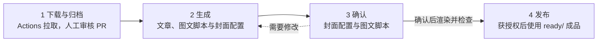

# 启发星球 · Inspire Planet

这里保存启发星球共同创作的会议资料、金句、分享文章与发布材料，以及整理这些内容的 AI skills。

启发星球是一个持续分享真实生活、问题、尝试和变化的共同学习空间。内容来自参与者的分享与讨论，保留发言归属，不把共同成果归为某一个人的个人知识库。

## 浏览内容

- [按期浏览会议资料](events/README.md)
- [当前活动信息](current.md)：只有经过确认的信息才用于新的邀请与发布文案。
- [下载会议转写稿](https://github.com/sunling/inspire-planet/actions/workflows/meeting-content.yml)：Actions 日常入口，无需填写日期或期数；[使用与维护说明](scripts/meeting-content.md)。
- [AI 工作流](.agents/skills/)：公众号文章、金句卡片、小红书/视频号图文和封面。

## 内容工作流



1. **下载与归档**：GitHub Actions 的 **Transcript draft** 发现最新项目会议，去重后拉取原始转写并创建公开 Draft PR，无需填写日期或期数。人工审核转写的公开范围与期次后合并；期次不明的材料先进入 `incoming/meetings/` 待确认。已有转写无需重复下载，自动拉取不可用时可由孙玲手动提供原稿。Actions 只负责获取转写，后续内容整理另行发起。
2. **生成**：准备公众号文章、小红书／视频号图文脚本、网站纪要 `summary.json`、金句 `quote-cards.json` 和 `assets/cover-configs.md`，也可只生成指定内容。`cover-configs.md` 是本期公众号封面的设计稿，按文章记录封面文字、布局、配色、设计意图和图片输出路径，供出图前审阅；确认后渲染工具按它生成图片。小红书／视频号首图的文字和主题放在各自图文脚本中。此阶段只交付文字与配置。
3. **确认**：审阅文章、公众号封面配置及小红书／视频号脚本；确认对应内容后再生成封面、渲染图卡并检查。命令与 prompt 放在本期 README 的这一步，成品统一更新到固定 `ready/`。
4. **发布**：当事人确认具体稿件与公开范围后，从 `ready/` 取对应平台的成品发布；发布日期和平台链接可记入发布备注。

每期 `README.md` 是操作入口，按“四步制作流程 → 稿件导航 → 发布备注”排列；不记录生成、审稿或渲染进度，不维护状态面板。命令使用本期真实路径，详细核对记录按需折叠。

## 文件结构

```text
events/{year}/{YYYYMMDD}-epXX/
  transcript.txt       会议原始转写
  README.md            本期导航、制作流程与发布备注（仓库内，不单独发公众号）
  gzh-{slug}.md        公众号分享文章（一位分享者一篇；末尾附标题与摘要）
  xhs-{slug}.md        小红书图文（一位分享者一篇）
  sph-{slug}.md        视频号图文（一位分享者一篇）
  quote-notes.md       历史金句与语境笔记
  summary.json         网站单期详情页的结构化分享纪要
  quote-cards.json     金句卡片与周刊数据
  assets/             只保存必要原图、配置与公众号封面
    cover-configs.md   公众号横版封面的配置与设计信息
    recap-cover-{slug}.jpg  公众号封面成品
.agents/skills/          生成上述内容的工作流
.github/workflows/      转写下载、历史补录与内容检查的 GitHub Actions
scripts/                Actions 调用的转写程序、内容检查与发布包渲染工具
  covers/               用 HTML 模板生成公众号封面
  text-cards/           把图文脚本渲染为小红书／视频号图卡
```

文件名规则：**渠道缩写-分享者英文 slug**（`gzh-liying.md` / `xhs-liying.md` / `sph-liying.md`）。一期选了谁、哪个渠道有内容，看文件名就知道。历史期沿用旧的 `recap.md` / `xiaohongshu.md` / `promo.md` 和 PNG 封面，不追溯改名或转换。

每期根目录放来源、稿件和索引，`assets/` 放必要原图、公众号封面配置与成品。小红书与视频号按平台分别编排图文脚本、选择主题、审阅并渲染整套图卡（含首图）。渲染成品统一使用仓库旁固定目录 `inspire-planet-publish/{YYYYMMDD}-epXX/ready/`，按 `gzh/`、`xhs/{slug}/`、`sph/{slug}/` 分目录交付；固定预览、ZIP 和旧版历史也在仓库外，规则与命令见 [固定发布目录](scripts/publish.md)。每期只保存实际存在的文件，不补空稿。历史资料保留原表达；原始转写可能包含识别错误，不能把它当作经过核实的事实或建议。历史文案中的会议时间和入口只代表当时状态。

## 网站与周刊数据

本仓库维护内容，网站仓库 `sunling/inspireplanet.cc` 负责读取与展示。每期 `summary.json` 用于单期详情页，`quote-cards.json` 用于金句卡片和周刊；两者独立编辑，事实都回查本期转写。完整发布包包含这两份 JSON；历史期缺少纪要时不补空文件。

字段、期次身份、溯源与审核后同步方式见 [内容数据约定](events/data-contract.md)。JSON 生成不等于获准公开；合并到 `main` 前完成内容与授权检查，网站会读取该分支的数据。

## 转写下载自动化

- **日常下载**：[Transcript draft](https://github.com/sunling/inspire-planet/actions/workflows/meeting-content.yml) → Run workflow → 选择 `main`，无需输入日期或期数。
- **定时下载**：已配置 UTC 周六 02:00、02:10、02:20 三次尝试（北京时间周六 10:00、10:10、10:20）；仅在仓库变量 `CONTENT_AUTOMATION_ENABLED` 为 `true` 时运行。定时触发可能延迟，必要时手动补跑。
- **历史补录**：[Historical transcript (advanced)](https://github.com/sunling/inspire-planet/actions/workflows/meeting-history.yml)。留空运行可先扫描，再按日期或扫描编号选择会议。

流水线需要 `TENCENT_MEETING_TOKEN` Secret 和 Actions 创建 PR 的权限；配置、去重和期次处理见 [维护说明](scripts/meeting-content.md)。生成的是**公开、未经人工审阅的 Draft PR**，不自动合并。自动化不调用模型、不生成文章、网站 JSON 或图片，也不操作网站或社交平台。后续内容整理在 ChatGPT/Codex 中单独发起，可继续使用同一内容分支。

## 参与整理

所有人都可以浏览本仓库，有 GitHub 账号即可通过 Issue 提出更正，或 Fork 后提交 Pull Request。直接写入权限由维护者另行授予。

更正时请说明期数、文件和原始依据；保留分享者署名，不把不同人的话拼成一句。公开新增材料前检查参与者同意范围、个人隐私及凭据。不要上传私人报名表、未获准公开的一对一材料或密钥。

仓库公开不代表对所有内容授予任意再利用许可；引用、改编或转载时应尊重作者署名及授权。

## 使用 AI skills

在本仓库根目录打开支持项目 skills 的 AI 工具，先读取 [AGENTS.md](AGENTS.md)。例如：

- “整理某期会议的完整发布包” → `inspireplanet`
- “写公众号文章 / 起标题 / 写摘要” → `inspireplanet-gzh`
- “提炼单期分享纪要” → `inspireplanet-summary`
- “提炼金句卡片” → `inspireplanet-cards`
- “生成小红书图文” → `inspireplanet-xhs`
- “生成视频号内容” → `inspireplanet-sph`
- 公众号封面 → `inspireplanet-gzh`，从 [3 种布局 × 5 套配色](scripts/covers/README.md) 中独立选择；小红书／视频号封面 → 与内页一起由 [图卡渲染器](scripts/text-cards/README.md) 生成，使用脚本中选定的主题与字体。


生成内容与真实发布分开；只有明确要求发布时才操作外部平台。
