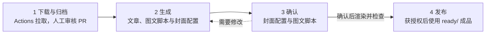

# EP40｜2026-10-10

李影读到“无聊之地”，抹茶回看一个月的加班，孙玲把本地模型探索与妈妈的微信助手需求分开。

## 制作流程



固定发布目录：`../inspire-planet-publish/20261010-ep40/`（相对仓库根目录），发布只用 `ready/`。预览固定为 `preview.html`，下载包为 `gzh.zip`、`xhs.zip`、`sph.zip`、`all.zip`。规则见 [固定发布目录](../../../scripts/publish.md)。

下面的命令均在仓库根目录执行。渲染环境安装见 [公众号封面说明](../../../scripts/covers/README.md) 和 [图卡说明](../../../scripts/text-cards/README.md)；需 Python 依赖、Chromium 和霞鹜文楷字体。本机字体无法自动找到时加 `--font <字体文件路径>`；使用已安装的 Chrome 时加 `--browser <浏览器文件路径>`。

### 1. 下载与归档

本期已有 [transcript.txt](transcript.txt)，无需重复下载。其他会议通过 GitHub Actions 获取，见 [下载说明](../../../scripts/meeting-content.md)；人工审核公开 Draft PR 的期次与公开范围后归档。原始转写不润色。

### 2. 生成发布包

使用本期转写生成公众号文章、小红书与视频号各自的图文脚本、网站纪要 `summary.json`、金句 `quote-cards.json`，以及 `assets/cover-configs.md`。需要时也可只生成某个渠道。此时先审稿，不出图。

`assets/cover-configs.md` 是本期公众号封面的设计稿：按文章记录封面文字、布局、配色、设计意图和图片输出路径，供出图前审阅；确认后渲染工具读取它生成封面图片。小红书／视频号首图的文字和主题放在各自图文脚本中。

Prompt：

> 使用 inspireplanet，基于 events/2026/20261010-ep40/transcript.txt 生成 EP40 发布包：公众号、小红书、视频号、网站纪要 summary.json、金句 quote-cards.json 和公众号封面配置。小红书与视频号分别编排；更新本期 README 的导航与制作流程，先不要渲染。

### 3. 确认

先确认对应文章、封面配置和图文脚本，再执行下面的出图命令。

#### 公众号封面

审阅 [assets/cover-configs.md](assets/cover-configs.md) 中的封面文字、布局、配色和对应文章。确认后运行：

```bash
python3 scripts/render-publish.py events/2026/20261010-ep40 --channel gzh
```

公众号待发布封面固定保存在 `../inspire-planet-publish/20261010-ep40/ready/gzh/`（相对仓库根目录）。

Prompt：

> EP40 的 assets/cover-configs.md 已确认，请按保存的布局与配色重新渲染 3 张公众号封面，检查排版并提供成品链接。

#### 小红书／视频号图卡

逐篇打开下方稿件导航中的小红书与视频号脚本，确认首图、每页文字、署名和主题。每篇可选不同主题，各自首图与内页保持一致；转写时间戳及编辑备注不出图。

确认后分别渲染六套图卡，成品和预览保存在仓库外：

```bash
python3 scripts/render-publish.py events/2026/20261010-ep40 --channel xhs --channel sph
# 只更新一篇时：
python3 scripts/render-publish.py events/2026/20261010-ep40 --channel xhs --slug liying
```

发布只使用固定 `ready/xhs/{slug}/`、`ready/sph/{slug}/` 中的图片。脚本先临时渲染与检查，成功后更新当前图片、预览与 ZIP；旧版存 `history/`。首图随内页生成，不跨平台复用成品，图卡不提交 GitHub。

Prompt：

> EP40 的小红书和视频号图文脚本已确认，请按各篇保存的主题分别渲染，共六套；首图随内页生成，通过 scripts/render-publish.py 更新仓库外固定发布目录，旧版存 history/，按平台和分享者分目录，检查后提供成品链接。

### 4. 发布

当事人确认具体稿件与公开范围后，由发布者上传对应平台的文案和图片。出图确认与发布授权分别记录；AI 仅在用户明确要求时操作外部平台。

实际发布日期和平台链接可记入下方发布备注。

## 稿件导航

| 分享者／选题 | 公众号 | 小红书 | 视频号 |
|---|---|---|---|
| 李影：读书与工作的无聊 | [文章](gzh-liying.md) | [图文脚本](xhs-liying.md) | [图文脚本](sph-liying.md) |
| 抹茶：回看记录与工作协作 | [文章](gzh-mocha.md) | [图文脚本](xhs-mocha.md) | [图文脚本](sph-mocha.md) |
| 孙玲：妈妈的微信助手 | [文章](gzh-sunling.md) | [图文脚本](xhs-sunling.md) | [图文脚本](sph-sunling.md) |

来源：[会议转写](transcript.txt)。公众号封面：[配置](assets/cover-configs.md) · [成品](assets/)。纪要：[分享脉络 JSON](summary.json)。金句：[6 条卡片 JSON](quote-cards.json)。

## 发布备注

- 公众号为分享者第一人称口述，需本人过目；文中互相引用的回应也需回应者确认。孙玲篇涉及妈妈，需确认妈妈的公开范围。
- 原始转写含现场个人信息；公开提交前需核对转写的授权与隐私范围。
- 活动节奏、会议入口、加入页与账号名称统一从 [current.md](../../../current.md) 读取；临时安排以本期通知为准。

<details>
<summary>会议与编辑核对记录</summary>

- 会议开始：2026-10-10 00:00 UTC／美西 2026-10-09 17:00／北京时间 2026-10-10 08:00；全段约 1 小时 29 分 38 秒，181 个发言块。原始转写未润色。
- 主要分享来源：李影 00:13:38–00:32:59；抹茶 00:33:22–00:55:01、01:12:01–01:13:53；孙玲 00:55:36–01:10:21、01:19:49–01:20:49。各稿保留具体出处。
- 未单独成篇：内容仓库与文章形式讨论、首次参与伙伴关于儿童绘本与 AI 情感的理解、问题圆桌设想；后两者未写为已验证结论或固定活动安排。
- 会议中讨论了引用分享的方式，但未记录三位对本次具体稿件的逐一确认；不把沉默视为审稿或授权。
- 署名未确认时可改为“一位读者”“一位记录营发起人”“一位给家人搭建助手的分享者”，同步替换稿件、图卡、封面和卡片姓名并重新出图；匿名版仍需授权。
- 已省略工作机构与电话安排、记录营另外两人的身份与个人经历、妈妈的账目与聊天原话；原始转写仍需单独核对公开范围。
- 书名统一为《The Phantom Tollbooth》，依据转写 00:14:00；疑似识别错误的角色、地名与生词不强行纠正或作为书中直接引语。“国庆节的前 33 周”只保留“国庆前”，不推断周数。
- 孙玲在 00:58:25 说“决定退掉”电脑，不写为已经退货；助手才使用几天，不宣称效果已验证。模型与云端体验为个人尝试。
- 封面无真实人物照片或二维码；公众号二维码待使用用户确认的原图。记录营“下一周开始”未进一步确认，不写作招募日期。

</details>
